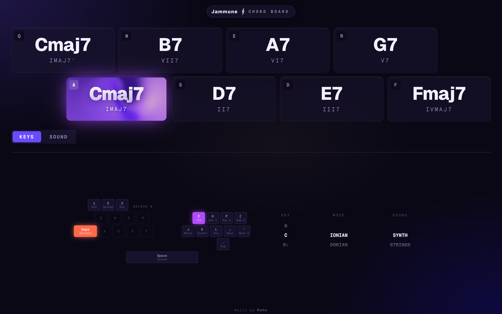
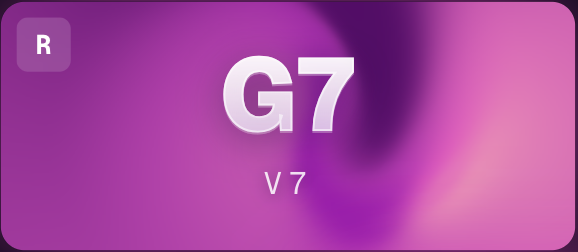
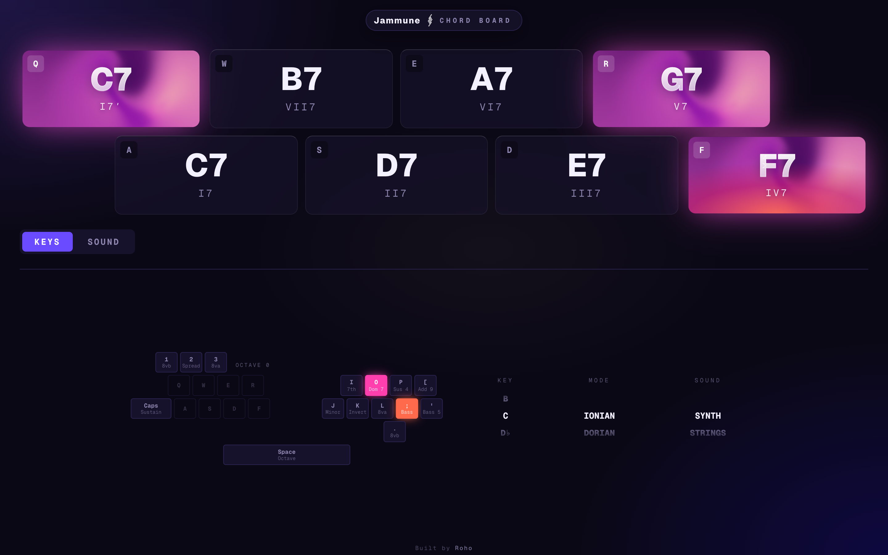
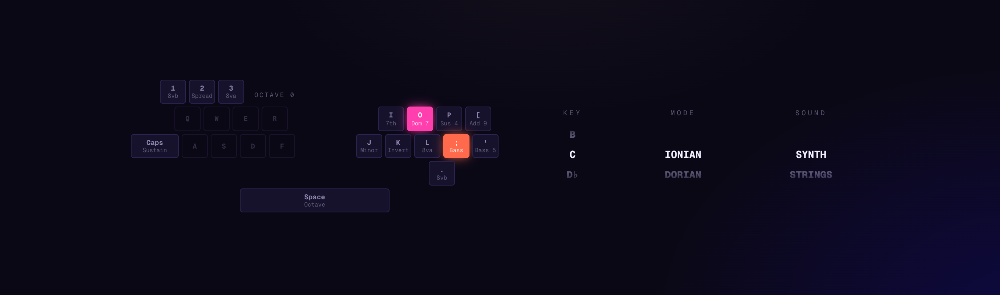
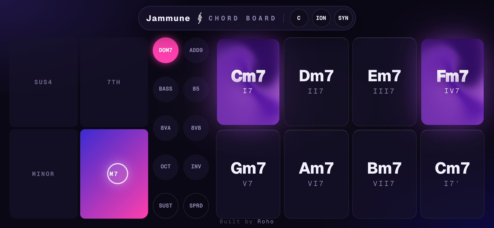
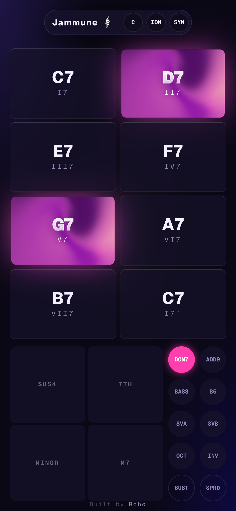
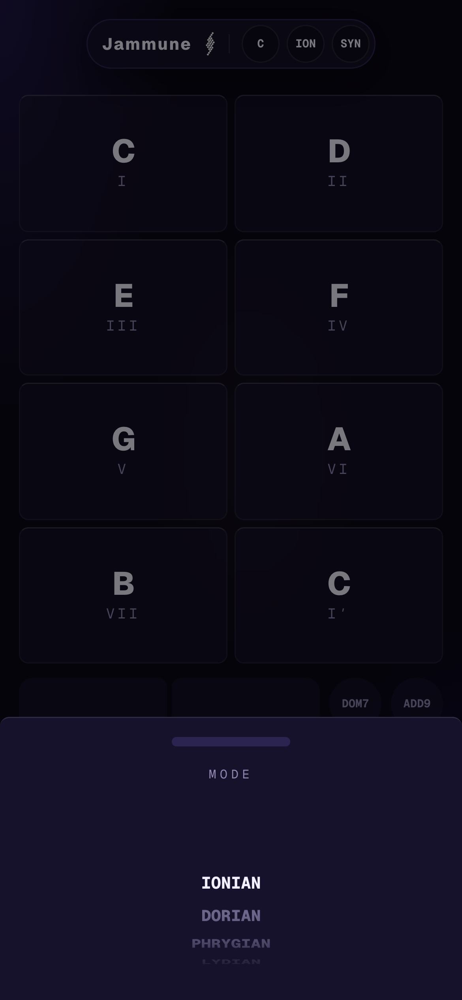

# Jammune

*A browser instrument for jamming with friends. Pick a key, hit a pad, play chords.*

## The idea

I wanted something I could open in a browser and just *play*: no DAW, no MIDI keyboard, no setup. Jammune turns your keyboard into eight chord pads. Pick a key and a mode, and A S D F / Q W E R become the eight chords of that scale. Hold a key on the right side of the keyboard to colour the chord: minor, 7th, sus4, add9, bass notes, octaves.

It's built for jamming, not lessons. That meant latency and feel came first, and the screen had to be readable at a glance in a dim room.

## Chords are derived, not looked up

There's no table of "mode → chord qualities" anywhere in the code. A scale is just a list of semitone steps, and every chord is built by stacking every other note of it: degrees *d*, *d+2*, *d+4*, wrapping round the octave. The chord's name comes from measuring its intervals back to the root.

The nice part: harmonic minor's augmented III and diminished vii°7 just *fall out* of that. There are no special cases, and the whole music-theory core is pure TypeScript with zero dependencies, unit-tested with Vitest.

## Pads that glow in the chord's colour

Every modifier has its own colour: indigo for minor, orchid for 7th, magenta for dom7, cream for add9. A sounding pad glows with a WebGL mesh gradient (Paper Shaders) tinted by whatever you're holding. Stack modifiers and the colours blend. Change one mid-chord and the pad morphs over 700 ms instead of snapping.

The key legend lights up in the same colours, so it teaches you the mapping while you play.

## On a phone it's a launchpad

Phones don't have a keyboard, so the layout changes completely. Hold the phone sideways and you get a launchpad: pads on the right, and a two-axis **modifier touchpad** on the left. Right adds the 7th, down makes it minor, top-left is sus4. Slide your thumb while a chord rings and it changes live. Everything is multi-touch, so one hand colours while the other plays.

  
  

Key, mode and sound live in bottom-sheet drawers (shadcn) behind little buttons in the header, each with a scroll wheel.

## The bug that took the longest

The phone version was silent at first. It turns out a touch only counts as permission to play audio when your finger *lifts*, not when it lands. A mouse counts on press, so desktop was fine. Every pad tried to start audio the moment a finger landed, got refused, and then never tried again.

The fix: the app creates its own audio context on load and keeps retrying it on every gesture the spec accepts, until it's actually running. It also tells iOS it's a playback app, so the ringer switch doesn't mute it.

## Stack

Next.js · TypeScript · Tone.js · Zustand · Tailwind v4 · Paper Shaders (WebGL) · shadcn/vaul · Vitest

*Built by [Roho](https://github.com/Roho7)*
